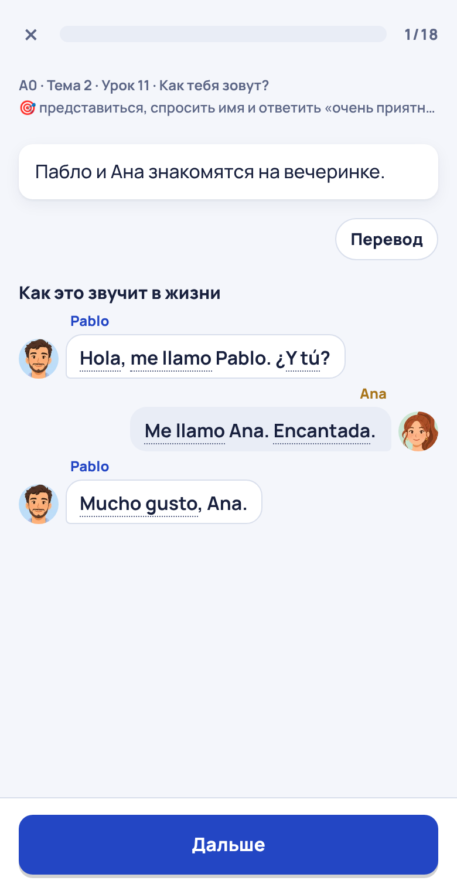
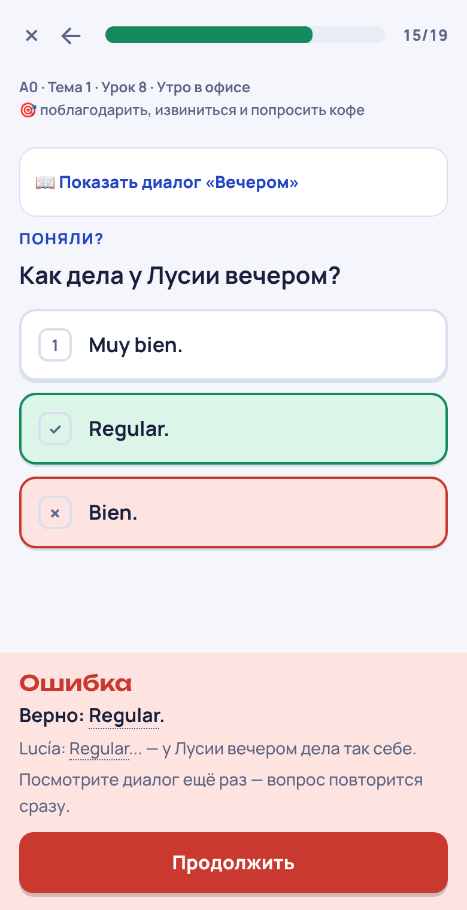
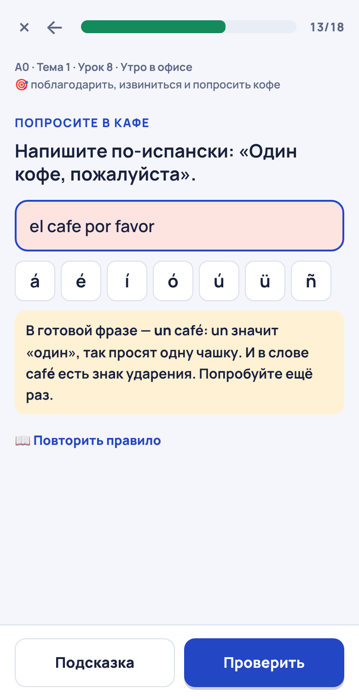
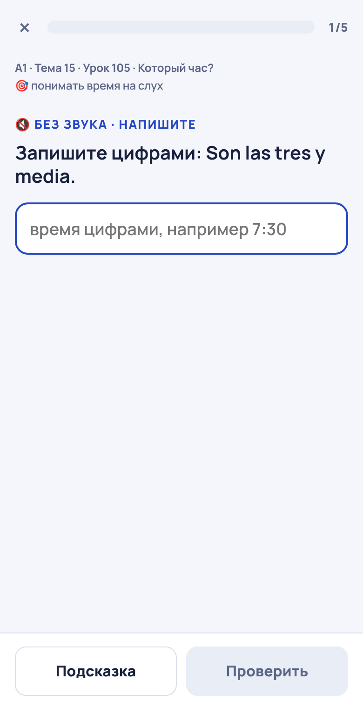
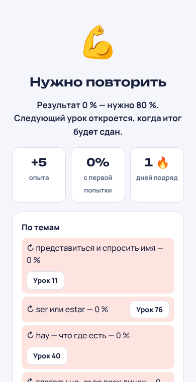

# Доводка основного курса A0–A1: итоговый отчёт

ТЗ «Комплексная доводка основного курса испанского A0–A1: 11 правок + обязательное проектирование карты экранов».
Отчёт от 9 ноября 2026 года.

- **Ветка:** `claude/a0-a1-rework-fixes`, создана от `ccr-f4c9bfd6-txio5n` @ `d5f6e27`. Работа шла маленькими
  коммитами: аудит, модель данных, движок, по коммиту на каждую тему, документы. В основную ветку **не слито**,
  PR не создан: это делается только с разрешения автора.
- **Предпросмотр:** https://claude-a0-a1-rework-fixes.espanolcadadia.pages.dev (собирает `site.yml`, все уроки открыты,
  в шапке метка «тест»). Основной сайт не менялся.
- **Документы:**
  - аудит и план — `docs/a0_a1_fixes_plan.md`;
  - журнал работы — `docs/a0_a1_fixes_progress.md`;
  - карты экранов — `docs/site_slide_maps/` (24 файла и `README.md`);
  - правила для авторов — `docs/site_lessons_guide.md`.

## Коротко

- Перестроены все 24 темы, 150 уроков сайта, строго по порядку 00 → 23. Для каждого урока сначала написана карта
  слайдов (таблица из 7 колонок и вводные), потом урок приведён к ней. У каждого урока теперь `version: 2`, а
  «Сигнатура» карты совпадает с шагами, которые строит движок (тест приёмки 13).
- В курсе больше нет:
  - титульных слайдов;
  - случайных «Вспомним»;
  - автодобавок в конце урока.

  Каждое слово урока спрашивается заданием в своём месте урока, и `validate` это проверяет.
- Оцениваемых заданий — 1152. Из них:
  - 241 привязано к своему диалогу, тексту или миссии (`source`);
  - 958 размечены навыком (всего навыков 102, реестр `content/site/skills.yaml`);
  - 476 ведут к своему правилу.
- Заданий на слух — 80, и у всех есть письменная альтернатива («Нет возможности слушать»).
- 143 задания поясняют ожидаемые ошибки (`mistakes`).
- Итог A0 (`familia/repaso`) и итог A1 (`final/examen`) — контроль с порогом 80 %. Тесты 23 тем оцениваются по тому же
  правилу (`check: soft`), но дальше пускают. В четырёх уроках «Повторение» (темы 5, 12, 16, 20) есть запланированное
  интервальное повторение навыков (блок `review`).
- Не тронуты:
  - `content/grammar/`, `content/units/` (Telegram) и `espanol/grammar_player.js` — diff с основной веткой пустой;
  - id и порядок уроков (тест-снимок);
  - голоса персонажей, картинки и устройство озвучки; новые фразы записала та же сборка `site.yml`.

## 11 правок: что было и что сделано

| № | Что было (аудит, `docs/a0_a1_fixes_plan.md`) | Что сделано | Чем проверено |
|---|---|---|---|
| 1 | Задание к диалогу показывало только вопрос, а сам диалог оставался на прошлом экране | `source: id` у задания. В задании — «📖 Показать диалог / текст» и «▶ Слушать ещё раз», на ПК — боковая панель; перевод до ответа скрыт | приёмка 3, проход в браузере с ошибками |
| 2 | Без записи задания на слух молча выкидывались, пустой урок давал 100 %, ошибка загрузки mp3 не ловилась | Статус звука, кнопки «Попробовать снова» и «Нет возможности слушать», альтернатива `noaudio` (иначе задание откладывается). Ноль оценённых заданий — урок не засчитан; у плеера есть `onerror` | приёмка 8 на `numeros/dictado` и `hora/escucha`, проход `--noaudio` |
| 3 | Прохождение старой версии урока считалось освоением новой | `P.ver[id]`: урок «обновлён — пройти новую версию», «Что вы уже умеете» показывает только подтверждённые цели, `mergeProgress` идемпотентен | приёмка 9 |
| 4 | Итоги засчитывались при любом числе ошибок | `check: control` — 80 %, баллы 1 / 0,5 / 0,25 / 0, ошибки не переспрашиваются. Не сдан — «Нужно повторить», слабые темы со ссылками на уроки, следующий урок закрыт. Тесты тем — `check: soft` | приёмка 10 на обоих итогах |
| 5 | «Повторить правило» вёл к ближайшему экрану теории по номеру шага, даже из другого витка | `rule: id`, без него — объяснение того же витка, при сомнении — `rule: none`. Каждая ссылка проверена по карте (`node tools/site_steps.cjs --unit N --done --refs`) | приёмка 11, `tests/test_site_refs.py` |
| 6 | «Вспомним» — два случайных задания без дат и интервалов | Навыки, `P.skills`: интервалы 1 / 3 / 7 / 14 / 30 / 60 дней, при ошибках интервал короче. «Повторить» → «Фразы и конструкции»; в уроках — блок `review` | приёмка 12 |
| 7 | Ввод сравнивался только с первым ответом; `el cafe por favor` получал «Пока не так» | Сравнение с ближайшим допустимым ответом и надёжные причины (артикль, ударение, `ñ`, форма, порядок слов, лишнее слово). Авторские `mistakes`, ступенчатая подсказка | приёмка 5, скриншот 3 |
| 8 | Ошибка в вопросе к диалогу возвращалась в конец урока | Повтор — сразу после своей группы вопросов, с открытым источником; в конец урока возвращаются только самостоятельные задания | приёмка 4, скриншот 2 |
| 9 | Урок открывался титульным слайдом «Урок N · Тема M» | Урок открывается первым блоком; уровень, тема, номер, название и цель — в шапке | приёмки 1 и 2, скриншот 1 |
| 10 | Самостоятельно исправленная ошибка давала красный итог | Итог `good` / `helped` / `revealed` / `bad`: исправил сам — зелёный «Верно» с пометкой «Исправлено ошибок: 1» | приёмки 6 и 7 |
| 11 | В начале урока шло «Вспомним», теория резалась по весу текста, в конец дописывались вопросы | Экраны задаёт автор: блоки подряд — один экран, `slide: new`. `recap` и `review` стоят там, где решила карта. `validate` проверяет покрытие слов, длинные и почти пустые экраны | приёмка 13 (сигнатуры всех карт), `validate` |

## Темы: карты и изменения

Карта каждой темы — `docs/site_slide_maps/NN_тема.md`. В каждой карте:

- вводные к каждому уроку: длина, лексика, порядок, что убрано или объединено и почему;
- таблица шагов из 7 колонок;
- сигнатура шагов движка.

| № | Тема | Карта | Что перестроено |
|---|---|---|---|
| 00 | Старт | [00_start.md](site_slide_maps/00_start.md) | 4 урока `version: 2`, noaudio у 15 заданий на слух, навыки vowels/stress/spell_* |
| 01 | Приветствия | [01_saludos.md](site_slide_maps/01_saludos.md) | 6 уроков `version: 2`; диалог-первый урок «Утро в офисе», вопросы к «Утром»/«Вечером» по `source`, кофе с `mistakes`, тест темы — сценарий без случайных вопросов |
| 02 | Знакомство | [02_presentarse.md](site_slide_maps/02_presentarse.md) | 5 уроков `version: 2`; «Как тебя зовут?» с разговора и мини-миссией «Познакомьтесь», вопросы к `party`/`hotel`/`neighbour`/`class`, тест темы — сценарий |
| 03 | Язык занятий | [03_en_clase.md](site_slide_maps/03_en_clase.md) | 5 уроков `version: 2`; практикум с задания, миссия с именем ученика, вопрос на ¿Cómo se dice…?, тест темы — сценарий |
| 04 | Числа | [04_numeros.md](site_slide_maps/04_numeros.md) | 8 уроков `version: 2`; 17 заданий на слух с альтернативой (число словами), диктант начинается заданием и без звука проходит «без звука», миссия с условием (возраст, номер) |
| 05 | Страны | [05_paises.md](site_slide_maps/05_paises.md) | 8 уроков `version: 2`; пустой экран-заголовок убран, заметки — у своих заданий, вопросы к тексту `amigos` и разговору `school`, «Большое повторение» с блоком `review` |
| 06 | Вещи | [06_cosas.md](site_slide_maps/06_cosas.md) | 7 уроков `version: 2`; два пустых экрана-заголовка убраны, ввод un/una — каждый вопрос к своему правилу, пояснения к ошибкам артикля и множественного числа, вопросы к тексту `mochila`, миссия `room` |
| 07 | Профессии | [07_trabajo.md](site_slide_maps/07_trabajo.md) | 7 уроков `version: 2`; ввод профессий принимает оба рода, практикум с задания, вопросы к тексту `marta` и разговору `party`, миссия `dorm` |
| 08 | Семья (итог A0) | [08_familia.md](site_slide_maps/08_familia.md) | 7 уроков `version: 2`; **итог A0 `familia/repaso` — `check: control`** (80 %, навыки у всех 10 заданий, слабые темы со ссылками, A1 закрыт до сдачи), альтернативы без звука, вопросы к `pablo`, `photos`, `olga` |
| 09 | Описание людей | [09_descripcion.md](site_slide_maps/09_descripcion.md) | 9 уроков `version: 2`; ввод к своим правилам (-o/-a, согласование, цвета, ojos), вопросы к `laura`/`karina`, миссия в аэропорту — самостоятельные задания с альтернативой |
| 10 | Дом | [10_casa.md](site_slide_maps/10_casa.md) | 8 уроков `version: 2`; тест к тексту перенесён от конца урока к тексту, карточки aquí/allí больше не разрывают объяснение, пояснения к «de el», «es en», «entre de» |
| 11 | Ser и estar | [11_ser_estar.md](site_slide_maps/11_ser_estar.md) | 5 уроков `version: 2`; практикум без вступления-пояснения, ввод к общему правилу ser/estar, вопросы к разговору `pablo`, миссия `call` |
| 12 | Город | [12_ciudad.md](site_slide_maps/12_ciudad.md) | 7 уроков `version: 2`; слова, проверявшиеся только автодобавкой, — парами и вопросами урока; вопросы к разговору `tom`, миссия `street`, текст `barrio`; «Повторение 9–12» с `review` |
| 13 | Еда | [13_comida.md](site_slide_maps/13_comida.md) | 7 уроков `version: 2`; заметки jugo и banana / papa перенесены к своим словам, дубль заметки о времени обеда убран, вступление `bar` — на экране разговора; правила `agua`, `con_de`, `er`, `er_ir`, `comer`, `bueno_bien`; слова из автодобавок — парами и вопросами; разговор `bar`, миссия `breakfast`, текст `spain` |
| 14 | Мне нравится | [14_gustos.md](site_slide_maps/14_gustos.md) | 7 уроков `version: 2`; вступления `tambien`, `dialogo`, `lectura` убраны с отдельных экранов (вопрос — убран, строки — на экран разговора и текста); «Juego ___ fútbol» вынесен из вопросов к разговору; правила `regular`, `ver`, `gusta_gustan`, `le_gusta`, `a_ana`, `tambien`, `scale`, `jugar_al`; слова из автодобавок — вопросами и вводом; разговор `lucia`, миссия `exchange`, текст `marta` |
| 15 | Время | [15_hora.md](site_slide_maps/15_hora.md) | 6 уроков `version: 2`; `hora/escucha` начинается заданием, у всех пяти заданий на слух — альтернатива «запишите цифрами» (тест приёмки 8 теперь проверяет и его); заметка о сиесте — на экране разговора; правила `el_los`, `es_son`, `y_menos`, `a_las`, `empieza`, `de_por`; слова из автодобавок — вопросами; разговор `museo`, миссия `library` |
| 16 | Мой день | [16_rutina.md](site_slide_maps/16_rutina.md) | 8 уроков `version: 2`; в `reflexivos` и `irregulares` слова и таблицы переставлены так, чтобы ввод шёл сразу после своей таблицы и правила; строка «Прочитайте…» убрана; ввод «После работы» принимает и «Después del trabajo»; правила `me_self`, `reflexive`, `lavar`, `e_ie`, `boot`, `antes_de`, `nunca`; текст `carlos`, миссия `ana_day`; «Повторение 13–16» с `review` |
| 17 | Покупки | [17_compras.md](site_slide_maps/17_compras.md) | 6 уроков `version: 2`; вступления убраны с отдельных экранов (ropa1 — убрано, demostrativos и tienda — на экран правила и разговора); правило cuesta / cuestan перенесено к заданию; «Me lo llevo» вынесен из вопросов к разговору; правила `color_after`, `enta`, `tens_y`, `este_ese`, `cuesta`, `hundreds`, `cientos`, `lo_la`; слова из автодобавок — парами и вопросами; разговор `clara`, миссия `jacket` |
| 18 | Погода и даты | [18_tiempo.md](site_slide_maps/18_tiempo.md) | 6 уроков `version: 2`; вступления `clima`, `muy_mucho`, `lectura` — на экране правила и текста; подсказка «hace mucho calor» получила задание; вопросы теста к тексту перенесены к остальным вопросам о тексте, повтор сортировки заменён; правила `hace`, `llueve`, `mucho_calor`, `en_verano`, `en_mes`, `fecha`, `muy_mucho`; слова из автодобавок — вопросами и парами; текст `clima`, миссия `kiev` |
| 19 | Планы | [19_planes.md](site_slide_maps/19_planes.md) | 6 уроков `version: 2`; ввод ir + a перенесён сразу к правилу, ввод «когда» — до заметки про para; вступление письма — на экране текста; два разговора приглашения — один экран, у каждого вопроса свой источник; правила `para`, `ir_a_inf`, `personal_a`, `tener_hay`, `sin_que`; слова из автодобавок — вводом и вопросами; разговоры `no_puedo`, `genial`, миссия `beach`, письмо `irina` |
| 20 | Здоровье | [20_salud.md](site_slide_maps/20_salud.md) | 6 уроков `version: 2`; совет «показывайте на себе» убран, вступления `doler`, `tener`, `medico` — на экране правила и разговора; заметка об аптеке — на экране миссии (экран разговора был длиннее 900 знаков); правила `mano`, `duele`, `articulo`, `tengo_hambre`, `mucha_hambre`, `hace_tengo`; выражения с tener — двумя парами; разговор `sergio`, миссия `consulta`; «Повторение 17–20» с `review` |
| 21 | Прямо сейчас | [21_ahora.md](site_slide_maps/21_ahora.md) | 4 урока `version: 2`; в `gerundio` слова первыми, вопрос, примеры и правило — один экран; в `llamada` вступление, вырезавшееся сборкой, переписано, заметка о ¿Diga? — на экране разговора; правила `estar_ger`, `especial`, `now_habit`, `habit_now`, `diga`; слова из автодобавок — вводом и вопросами; миссия `video`, разговор `llamada` (скрыт, без звука открывается текст) |
| 22 | Что вы сделали | [22_experiencias.md](site_slide_maps/22_experiencias.md) | 4 урока `version: 2`; в `perfecto` слова первыми, вопрос, примеры, haber и правило — один экран; вступления `experiencia` и `lectura` — над карточками и текстом; правила `perfect`, `irregular`, `nada_entre`, `alguna_vez`, `he_estado`; слова из автодобавок — вводом и вопросами; миссия `interview`, текст `my_year` |
| 23 | Финал | [23_final.md](site_slide_maps/23_final.md) | 4 урока `version: 2`; `final/examen` — `check: control` (80 %), вопросы — блоком `choose` с навыком у каждого, без титульного слайда (тест приёмки 10 проверяет и его); «Неделя в Севилье» — тренировка, у каждой из шести миссий свои задания и навыки, на слух — с альтернативой; текст `madrid`; в `fin` «что вы умеете» и «что дальше» — два экрана |

Общие изменения во всех темах:

- у вопросов к диалогам, текстам и миссиям — явный `source`, у заданий после них, которые от источника не зависят, —
  `free: true`;
- у тестов тем — разминка `match` и навыки у вопросов;
- формат ввода говорит, что именно вводить (одна форма, с артиклем или без, число словами);
- естественные варианты ответа принимаются: например, «Después del trabajo», «el viernes próximo», «Ceno en casa
  normalmente».

## Модель данных и прогресс учеников

- **YAML урока.** Новые поля урока — `version`, `check`. Новые поля задания:
  - `source` и `free`;
  - `rule`;
  - `skill`;
  - `mistakes`;
  - `noaudio`.

  Новые блоки — `recap` и `review`. У блоков-источников и объяснений — `id`, у экрана — `slide: new`. Подробно —
  `docs/site_lessons_guide.md`.
- **Реестр навыков** — `content/site/skills.yaml`, 102 навыка: название и урок, где навык вводится.
- **Прогресс.**
  - Новые ключи: `P.ver` (пройденная версия урока, звёзды, точность, «без звука»), `P.skills` (интервалы навыков),
    `P.ctl` (попытки итогов).
  - `P.done`, `P.words` и id уроков не менялись: старое прохождение не стирается, а урок получает пометку «обновлён».
  - Запись без версии считается версией 1, поэтому миграция идемпотентна.
  - `mergeProgress` объединяет новые ключи с копией у бота, а серверу (`bot/src/site.js`) правки не нужны.
  - Данные учеников не удаляются.

## Проверки (9 ноября 2026)

| Проверка | Результат |
|---|---|
| `python -m espanol validate` | ✅ Ошибок нет: 151 урок, 24 темы, 615 слов; предупреждений об экранах нет |
| `python -m pytest -q` | 277 passed |
| `node --test tests/site_course.test.cjs tests/site_grammar.test.cjs` | 161 / 161, в том числе приёмки 1–13 |
| `node --test bot/test/*.test.js` (после `python -m espanol bot-data --no-audio`, как в CI) | 44 / 44 |
| Проход в браузере `tools/site_walk.mjs`: 150 уроков × 320 / 390 / 430 px × (верно, с ошибками, без звука) | 1350 проходов (150 уроков × 3 ширины × 3 режима), без ошибок JS и без горизонтальной прокрутки; каждый урок дошёл до экрана результата; «не засчитан» — только итоги с ошибками (2 урока: familia/repaso, final/examen) |
| `git diff origin/ccr-f4c9bfd6-txio5n --stat -- content/grammar content/units espanol/grammar_player.js` | пусто |
| CI на ветке («Проверка курса», «Сайт курса») | зелёные для `6a22f70` (тема 23): тесты прошли; сборка предпросмотра записала озвучку для 3771 из 3771 фраз и выложила сайт на адрес ветки |

## Изменённые файлы

- **Движок страницы:** `espanol/site_template.html`. В нём поток урока, источник в задании, итог задания, ввод и
  подсказки, «Повторить правило», звук, версии, навыки и контроль.
- **Сборка и проверки:**
  - `espanol/course.py` — разбор новых полей;
  - `espanol/site.py` — ссылки задания в индексы блоков;
  - `espanol/scenario.py` — строгие проверки перестроенных уроков, экраны;
  - `espanol/lexicon.py` — «только пройденные слова» в `mistakes` и `noaudio`;
  - `espanol/site_audio.py` и `espanol/__main__.py` — предупреждения `validate`.
- **Контент:** `content/site/units/00…23_*.yaml`, `content/site/skills.yaml`.
- **Инструменты:**
  - `tools/site_vm.cjs` — движок страницы в `node:vm` для тестов;
  - `tools/site_steps.cjs` — шаги, сигнатура и ссылки урока;
  - `tools/site_walk.mjs` — проход в Playwright.
- **Тесты:** `tests/site_course.test.cjs` (приёмки 1–13), `tests/test_site_refs.py`, `tests/test_scenario.py`.
- **Документы:**
  - `docs/a0_a1_fixes_plan.md`, `docs/a0_a1_fixes_progress.md`, этот отчёт и скриншоты
    `docs/a0_a1_fixes_report/`;
  - `docs/site_slide_maps/`, `docs/site_lessons_guide.md`;
  - статус в `docs/a0_a1_rebuild_plan.md` (раздел 8), абзац в `CLAUDE.md`.

## Ограничения и что осталось

- **Озвучка новых фраз.** Новые реплики, варианты и ответы записывает только сборка `site.yml` (кэш голосов
  Испании). Локально записей нет — поэтому локальный проход в браузере и есть проверка «без звука». Что сборка
  предпросмотра записала все новые фразы, видно по её логу (строка CI в таблице выше).
- **Язык.** Испанский и русский проверены мной, но не носителем. Лучшая проверка — пройти темы на телефоне на
  предпросмотре и прислать правки: формат позволяет менять задания, не трогая движок.
- **Ввод с одним ответом.** У 258 из 381 заданий ввода один допустимый ответ. Почти всегда это форма, у которой
  второго варианта нет: герундий, причастие, число словами, форма глагола. Где естественный вариант есть, он
  добавлен.
- **Старый путь движка.** Нарезка теории по весу, автодобавки и «Вспомним» остались в коде для уроков без сценария.
  На сайте таких уроков нет: единственный, вводный урок канала `start/intro`, на сайте не показывается. Удалить этот
  код можно отдельной задачей; сейчас на него опираются тесты прежнего пути.
- **Картинки.** Используются только существующие картинки слов. Новых листов для тем 9–23 (еда, одежда, тело) нет.
- **Уже пройденные уроки.** У учеников, прошедших уроки до доводки, они помечены «обновлён — пройти новую версию».
  Опыт за новую версию начисляется полностью, а «Что вы уже умеете» подтверждается только новой версией.

## Скриншоты (390 px)

| | |
|---|---|
|  |  |
| 1. Урок «Как тебя зовут?» открывается сразу разговором; уровень, тема и цель — в шапке | 2. Вопрос к диалогу «Вечером»: источник в задании, вопрос повторится сразу |
|  |  |
| 3. «el cafe por favor» — авторское пояснение и «Повторить правило» | 4. `hora/escucha` без звука — «Запишите цифрами: Son las tres y media.» |
|  | |
| 5. Итог A1 не сдан: «Нужно повторить», 0 % из 80 %, слабые темы со ссылками на уроки | |
